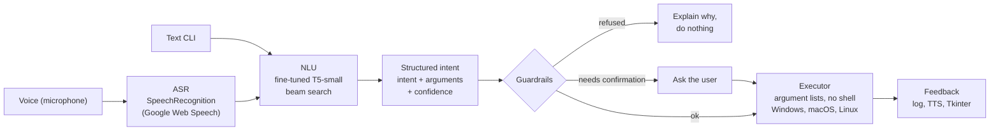

# Voice OS Agent

**Voice-controlled OS agent: a fine-tuned T5 model turns natural-language requests into validated, safely executed system actions.**


> "open firefox and go to github.com" → `{"intent": "open_app_and_go_url", "app": "firefox", "url": "github.com"}` → guardrails → `open -a Firefox https://github.com`

<!-- TODO: record docs/demo.gif (see "Recording the demo" at the bottom) -->
<!--  -->

## Architecture



Guardrails = intent and app allow-lists, path sandbox, URL check, confirmation of destructive or low-confidence actions (details below).

| Stage | Code |
|---|---|
| Speech recognition | [`asr/listener.py`](src/voice_os_agent/asr/listener.py) |
| T5 parsing + confidence | [`nlu/parser.py`](src/voice_os_agent/nlu/parser.py), [`nlu/json_utils.py`](src/voice_os_agent/nlu/json_utils.py) |
| Guardrails | [`safety/validator.py`](src/voice_os_agent/safety/validator.py) |
| Execution | [`executor/actions.py`](src/voice_os_agent/executor/actions.py) |
| Agent loop (plan → validate → execute) | [`agent.py`](src/voice_os_agent/agent.py) |
| Interfaces | [`cli.py`](src/voice_os_agent/cli.py) (text), [`ui/gui.py`](src/voice_os_agent/ui/gui.py) (Tkinter + voice), [`tts/speaker.py`](src/voice_os_agent/tts/speaker.py) |

## Why it is an "agent"

It is a small, tool-using agent with the language model kept on a short leash:

- **The model chooses an action among allowed tools.** The fine-tuned T5 maps a request to one of ~40 intents (the "tools": `open_app`, `move_file`, `search_web`, `set_timer`, ...) and fills its arguments.
- **The output is structured**, not free text: a flat `{"intent": ..., "<slot>": ...}` object, parsed without ever evaluating code.
- **Validation happens before execution.** The model never touches the OS. A deterministic layer checks the plan, and only then does the executor run it. The model is called **once** per request (plan → preview/confirm → execute).

This is the same pattern as LLM function calling, with a 60M-parameter model that runs locally on a laptop CPU.

## Security and guardrails

The model is treated as **untrusted input**: anything it outputs could come from a misheard or adversarial request.

| Guardrail | What it does |
|---|---|
| Intent allow-list | Unknown intents (`"rm -rf"`, `start_service`, ...) are refused. There is no generic "run a command" tool. |
| App allow-list | Apps are fuzzy-matched against a fixed list (`firefox`, `chrome`, `vscode`, ...). `powershell` and `regedit` are refused. |
| Path sandbox | Every path (source, destination, new name, archive name **and** archive members) must be a relative path that resolves, **after symlinks**, inside `VOA_WORKSPACE`. `..`, absolute paths, `~`, drive letters and UNC paths are refused. |
| URL check | Only `http(s)` URLs with a real host. `javascript:`, `file:` and URLs containing shell metacharacters (`& ; \| $` …) are refused. |
| No shell | Every process is started with an argument list. On Windows, `cmd /c start ... shell=True` was replaced by `os.startfile`. |
| Confirmation | `delete_file`, `shutdown`, `restart` and `logout`, and any parse below a confidence threshold, require explicit confirmation. |
| Dry run by default | The CLI only previews unless `--execute` is passed. |

**Tests:** [`tests/test_safety.py`](tests/test_safety.py) covers `../../etc/passwd`, `C:\Windows\...`, symlink escapes, unsafe move/copy destinations, rename targets, zip input/output, dangerous URLs, apps outside the allow-list and unknown intents. [`tests/test_agent.py`](tests/test_agent.py) runs the whole agent with a fake model and checks that a traversal never deletes the victim file. The tests need neither `torch` nor the weights.

**Before and after.** The original prototype refused the obvious `../../etc/passwd` but had **6 bypasses**: unchecked move/copy destinations, folder operations falling back to the raw path, unchecked rename targets and zip names, and a `shell=True` URL injection on Windows. On the [22 adversarial requests](data/adversarial.jsonl), passed through the real model:

| | Original guardrails | New guardrails |
|---|---|---|
| Reached the OS with an escaping path or unsafe URL | **5 / 22** | **0 / 22** |

Details for each case: [`evaluation/results.md`](evaluation/results.md#adversarial-inputs-full-agent-dry-run). The guarantee comes from the deterministic layer, not the model. **The confidence score does not help:** none of the wrong parses fell below the 0.85 threshold (see Results).

## Results

Measured with [`evaluation/evaluate.py`](evaluation/evaluate.py). All numbers are in [`evaluation/results.json`](evaluation/results.json), broken down by intent and category in [`evaluation/results.md`](evaluation/results.md).

> ⚠️ **Rebuilt test set.** The original test split was lost. [`data/test_rebuilt.jsonl`](data/test_rebuilt.jsonl) (407 examples, 32 intents) was **written after training** by the author of this repository with [`data/build_test_set.py`](data/build_test_set.py): templates, synonyms, filler words, one-character typos, long sentences, and 30 hand-written hard or ambiguous cases. The output schema was inferred from the inference code and one canonical query per intent; gold values come from the sentences. Its phrasings differ from the (unknown) training templates, so it **may be easier or harder than the original test set**. Treat these numbers as indicative.

| Decoding | Exact match (strict) | Exact match (parsed) | Intent accuracy | ROUGE-L F1 | Latency p50 | Latency p95 |
|---|---|---|---|---|---|---|
| Beam search (4), used by the app | 48.4 % | 56.8 % | 76.2 % | 0.868 | 575 ms | 924 ms |
| Greedy | 46.9 % | 55.5 % | 75.2 % | 0.858 | 234 ms | 389 ms |

*Exact match (strict)*: the raw output equals the canonical target string. *Exact match (parsed)*: same dict, values compared case-insensitively. *ROUGE-L*: token-level LCS F1 between raw output and target. *Latency*: model call only (tokenize + generate + decode), batch size 1, after warm-up, on an **Apple M1 (8 GB) MacBook, CPU only**, 4 threads, torch 2.9.1.

| Category | n | Exact match (parsed) | Intent accuracy |
|---|---|---|---|
| clean | 167 | 68.3 % | 85.0 % |
| filler words | 84 | 63.1 % | 81.0 % |
| long sentence | 63 | 44.4 % | 66.7 % |
| one typo | 63 | 33.3 % | 61.9 % |
| hand-written hard cases | 30 | 50.0 % | 63.3 % |

**What goes wrong** (from [`results.json`](evaluation/results.json) → `errors_beam4`):
- **Invented intents** on unseen phrasings: "fire up spotify" → `fire_app`, "is it going to rain in Paris" → `confirm_action`, "louder" → `song_music`. These are refused by the allow-list, so they fail safely.
- **Corrupted slot values, some leaking from T5's translation pre-training**: "cheap flights" → "billig flights" (German), "transformer" → "transformator", "Tokyo" → "Tokio", `invoice_2025.pdf` → `voice_2025.pdf`.
- **Missing or renamed slots**: the destination of `move_file`/`copy_file` is often dropped or put under another key. "open X in vscode" consistently gives `open_file_in_specific_app`, probably a convention from the lost training labels (counted as an error).
- **Overconfidence**: mean confidence is 0.967 on wrong parses vs 0.995 on correct ones. A threshold cannot separate them.

**Course report figures.** The original course report states 95 % exact match, ROUGE-L 0.98 and 100–400 ms latency on its synthetic test split (5,760 examples). These are **reported in the original course report, not reproducible (test set lost)**, and were not reproduced on the rebuilt set above.

## Installation and usage

```bash
git clone https://github.com/benk-007/voice-os-agent.git && cd voice-os-agent
python -m venv .venv && source .venv/bin/activate
pip install -r requirements.txt && pip install -e .
```

**Model weights.** By default the agent loads `./models/t5-semantic-parser-final/`. Otherwise it uses the Hugging Face Hub id `benk-007/t5-small-os-commands`, downloaded on first run. *(Hub upload pending.)* Set `VOA_MODEL_DIR` to use another location (see [`.env.example`](.env.example)).

**Text CLI** (no microphone; dry run unless `--execute`):

```bash
python -m voice_os_agent "open firefox and go to github.com"
python -m voice_os_agent --execute "create a file called notes.txt"   # inside ~/safe_workspace
python -m voice_os_agent --execute --yes "delete notes.txt"           # destructive: needs --yes
python -m voice_os_agent                                              # interactive REPL
```

```
> delete ../../etc/passwd
  model   : "filename":"../../etc/passwd","intent":"delete_file"
  intent  : delete_file   confidence: 98.0%   latency: 710 ms
  status  : validation_failed (unsafe_path)
```

**Voice GUI** (microphone, Tkinter, speech output):

```bash
pip install -r requirements-voice.txt     # PyAudio needs portaudio: brew install portaudio
python -m voice_os_agent --gui
```

**Docker** (text mode, CPU-only PyTorch, non-root user, file actions confined to `./workspace`). ⚠️ *The Dockerfile has not been tested yet.*

```bash
docker compose build
docker compose run --rm agent "open firefox and go to github.com"
docker compose run --rm agent                       # REPL
docker compose run --rm --entrypoint python agent evaluation/evaluate.py
```

**Tests and evaluation:**

```bash
pip install -r requirements-dev.txt
pytest                                  # 101 tests, < 1 s, no model needed
python evaluation/evaluate.py           # ~7 min on an M1 CPU, writes evaluation/results.{json,md}
```

## Training

The model is [`t5-small`](https://huggingface.co/t5-small) (60.5M parameters) fine-tuned for sequence-to-sequence semantic parsing. Input: `semantic_parse: <utterance>`. Target: `"key":"value"` pairs sorted by key.

- **Data:** a synthetic, template-based English dataset. The course report describes 48,000 examples, 60 intents, typos and filler-word augmentation, and an 88/12 split. The generator and the dataset were not preserved.
- **Hyper-parameters** (extracted from the `training_args.bin` saved with the weights → [`training/training_args.json`](training/training_args.json)): 3 epochs, AdamW, learning rate 3e-5, linear schedule without warm-up, batch size 8, weight decay 0.01, seed 42, fp32.
- **Re-training:** [`training/train.py`](training/train.py) is a **reconstruction** of the setup (Hugging Face `Seq2SeqTrainer`) for a JSONL file `{"input": ..., "target": {...}}`. It has not been re-run end to end.

```bash
pip install datasets accelerate
python training/train.py --train-file data/train.jsonl --output-dir models/my-t5
```

## Limitations and next steps

- **Accuracy on unseen phrasings is limited** (56.8 % exact match on the rebuilt set; typos and long sentences hurt most). Training on more diverse, partly human-written data, and building a real held-out test set, are the first things to do.
- **Replace T5 with an LLM that supports function calling**: tool schemas instead of a fixed output vocabulary, so it generalizes to paraphrases. The guardrail layer stays the same.
- **Replace Google speech recognition (cloud) with a local model (Whisper)**, for privacy and offline use: audio currently leaves the machine.
- **Add RAG over command documentation**, so the agent can answer "how do I…" questions and pick tools it was not trained on.
- **Better confidence**: the sequence probability is not calibrated (see Results). Alternatives: calibration on held-out data, agreement between beams, or a schema check per intent.
- Several intents are parsed but not implemented by the executor (`send_email`, `weather`, `translate_text`, …). `lock_screen` on recent macOS versions and `shutdown` (via `sudo`) need adjustments.
- The test set is larger and more varied than a smoke test, but it is synthetic and written by one person.

## Context and authors

Project developed at **ENSIAS** (Mohammed V University, Rabat) for the *Text Mining* course, 2025–2026, supervised by Pr. Taoufik Rachad, **with Rabie Ermoug and Firas Mahboub**. This repository is my cleaned-up and extended version.

**Contributions to the original course project (2025):**
- **Mokhtar Benkirane** (lead author):
  - designed the full architecture (ASR → T5 semantic parsing → structured output → validation → OS execution);
  - built the dataset and fine-tuned T5-small;
  - developed the execution engine, the initial safety layer, the Tkinter interface and speech synthesis.

Co-authors of the original course project (ENSIAS, 2025): Rabie Ermoug and Firas Mahboub.

### Version 2 (2026)

The following work was done **after the course project**, by Mokhtar Benkirane, for this public repository:
- refactoring of the single-file prototype into modules (`asr`, `nlu`, `safety`, `executor`, `tts`, `ui`), a text CLI and a Dockerfile;
- security fixes:
  - path sandbox rewrite, which closes 6 path-traversal bypasses;
  - URL validation;
  - removal of `shell=True`;
- **101 unit tests**, mostly on the guardrails;
- bug fixes:
  - confidence computed on the chosen sequence;
  - a single model call per request;
  - `open` on macOS instead of `xdg-open`;
  - typographic quote normalization;
  - the `newname` key for renames;
  - a crash in the microphone error handler;
- the **rebuilt test set**, the adversarial set and the reproducible evaluation script (`evaluation/evaluate.py`).

The original prototype is kept unchanged in [`_archive/original/`](_archive/original/).

Mokhtar Benkirane · M2 Computer Science, Sorbonne Université · [github.com/benk-007](https://github.com/benk-007)

License: [MIT](LICENSE) © 2025–2026 Mokhtar Benkirane, Rabie Ermoug, Firas Mahboub.

---

### Recording the demo

On macOS: launch `python -m voice_os_agent --gui` (or the CLI in a terminal), press **⌘⇧5 → Record Selected Portion**, and say or type 3–4 commands (one normal, one refused, one needing confirmation). Then convert the recording:

```bash
ffmpeg -i demo.mov -vf "fps=10,scale=900:-1" -loop 0 docs/demo.gif
```

Uncomment the `docs/demo.gif` line at the top of this README.
